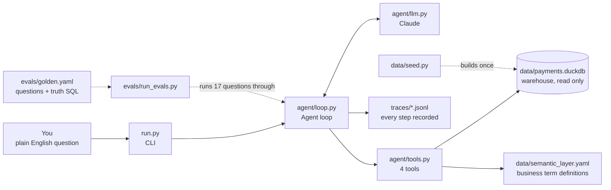
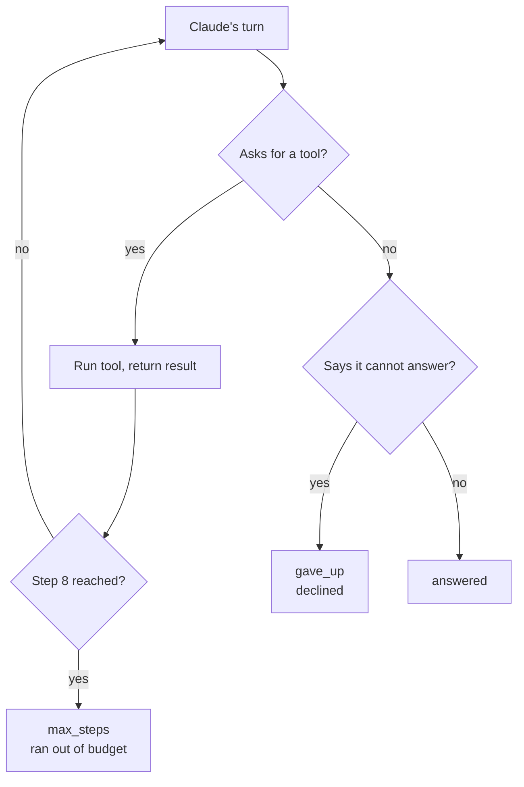
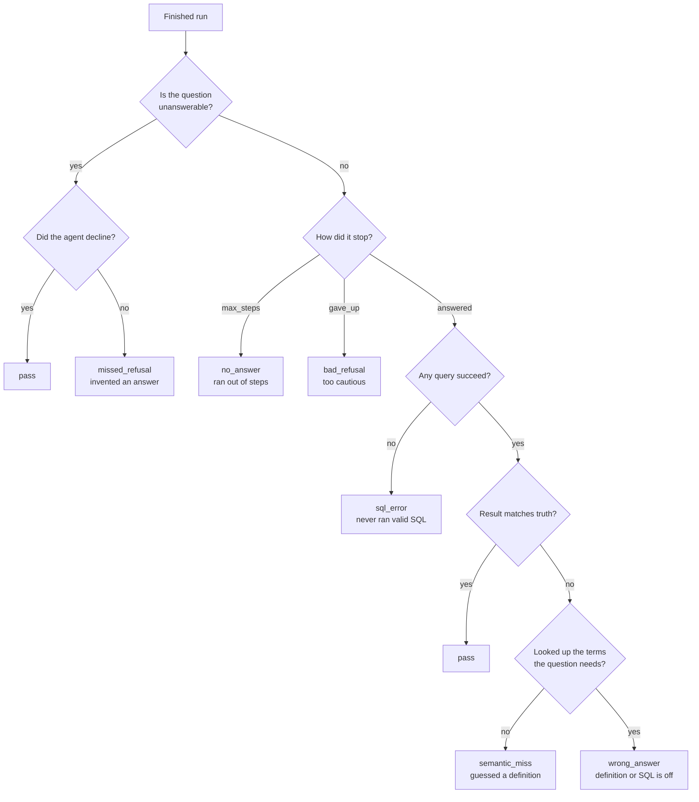

# Architecture

Three views of the same system: the big picture, one question end to end, and
how the evals score a run. Diagrams are Mermaid and render on GitHub.

---

## 1. The big picture



The key idea: **Claude never touches the data.** It only asks for tools to be
run. The code runs them and hands the results back. Claude is the brain,
the tools are the hands.

---

## 2. One question, step by step

```mermaid
sequenceDiagram
    autonumber
    actor You
    participant Loop as Agent loop
    participant Claude
    participant Tools
    participant DB as Warehouse
    participant Sem as Semantic layer

    You->>Loop: "How many active merchants are there?"
    Loop->>Claude: question + system rules + tool list

    Note over Claude,Tools: ORIENT
    Claude->>Tools: list_tables()
    Tools-->>Claude: merchants, txns, disputes, payouts

    Note over Claude,Tools: INSPECT
    Claude->>Tools: get_schema("merchants")
    Tools->>DB: read column info
    Tools-->>Claude: columns + warnings

    Note over Claude,Sem: DEFINE
    Claude->>Tools: lookup_term("active merchant")
    Tools->>Sem: find definition
    Tools-->>Claude: "closed_dt IS NULL"

    Note over Claude,DB: QUERY
    Claude->>Tools: run_sql("SELECT ... WHERE closed_dt IS NULL")
    Tools->>DB: execute, read only
    alt query fails
        Tools-->>Claude: error text, not a crash
        Note over Claude: REPAIR: read error, fix SQL, try again
    else query works
        Tools-->>Claude: rows, max 50
    end

    Note over Claude,You: ANSWER
    Claude-->>Loop: "There are N active merchants..."
    Loop-->>You: answer + stop_reason
```

### The named steps

| # | step | tool | what happens | why it exists |
|---|---|---|---|---|
| 1 | **Ask** | none | Your question goes to Claude with the rules and the tool list | Claude needs to know what it is allowed to do |
| 2 | **Orient** | `list_tables` | Claude learns which tables exist | It starts knowing nothing about this database |
| 3 | **Inspect** | `get_schema` | Claude reads columns plus warnings like "amounts are in cents" | The data is messy on purpose; the warnings carry the traps |
| 4 | **Define** | `lookup_term` | Claude looks up what a business word means | "Active" is a business rule, not a column. Guessing it is the #1 failure |
| 5 | **Query** | `run_sql` | Claude writes SQL, the code runs it | The only way to get a number |
| 6 | **Repair** | `run_sql` again | If the SQL failed, the error goes back to Claude and it fixes the query | Errors are returned, never raised, so the run survives |
| 7 | **Answer** | none | Claude states the number in a sentence and stops | The loop ends when Claude stops asking for tools |
| 8 | **Record** | none | Every step was written to `traces/*.jsonl` | You cannot debug an agent you cannot replay |

Claude chooses the order itself. It can skip steps or repeat them; the table is
the typical path, not a fixed script.

### How a run ends



Three different endings, kept separate because each one needs a different fix.

### Safety rails

| rail | where | protects against |
|---|---|---|
| Read only, twice | regex in `run_sql` + DuckDB opened `read_only=True` | Claude writing `DROP TABLE` |
| 50 row cap | `MAX_ROWS` in `tools.py` | A huge result flooding Claude's context |
| 8 step cap | `MAX_STEPS` in `loop.py` | A run that never ends, and the API bill |

---

## 3. How the evals score a run

`evals/run_evals.py` runs each of the 17 questions in `golden.yaml`, runs the
truth SQL itself, and compares results. Every run lands in exactly one bucket:



**Trap questions:** 8 of the 17 have an obvious reading that gives a wrong
answer that still looks believable. "How many active merchants?" answered as
"count all merchants" runs fine and is wrong. Trap accuracy is the score on
those 8 alone, and it is the number that shows whether the semantic layer is
doing its job.
